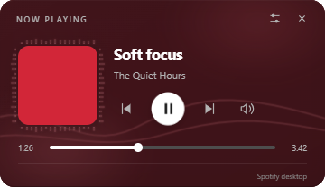

# SpotifyPiP

A compact floating controller for the Spotify desktop app on Windows, created by **[Devashish Bobby](https://github.com/devashishbobby)**. Built with Tauri 2, React, TypeScript and Rust.



The preview uses fictional metadata and original synthetic artwork. Real playback uses the artwork exposed by Spotify's Windows media session.

## Features

- Summon or hide the player from any app with **Ctrl+Alt+M**.
- Desktop shortcut for easy access; **Start when Windows boots up** switch in Settings, enabled by default.
- Custom app and shortcut icon from `debra.jpg`; clear Now Playing / Paused header labels without a status dot.
- Real song, artist, artwork, playback state and timeline from Windows GSMTC.
- Spotify-only play/pause, previous/next, conditional seeking and per-app volume/mute.
- Album-reactive blurred glass with the approved Phase 3 background preserved.
- Thin equalizer bars on **all four sides** of the existing cover, themed from its colors.
- Short, reversible show/hide animations; X and Escape hide to tray without pausing Spotify.
- Draggable, borderless window; persistent position and always-on-top preference; single-instance handling.
- Dark fallback states, keyboard accessibility and reduced-motion support.

The visualizers are **simulated playback-reactive animation**, not beat detection. GSMTC provides no audio samples. SpotifyPiP does not capture audio, use the microphone, play music itself, or require Spotify OAuth/Web API credentials.

## Run locally

Requirements: x64 Windows 10 version 1809 or later / Windows 11, Spotify desktop, WebView2 Runtime, Node.js/npm, stable Rust MSVC, and Visual Studio C++ Build Tools with the Windows SDK.

```powershell
npm.cmd install
npm.cmd run tauri dev
```

`npm.cmd` avoids PowerShell execution-policy restrictions on `npm.ps1`; `npm run tauri dev` also works in shells that permit it. Opening the app shows the player. Press **Ctrl+Alt+M**, or use the tray's **Show / Hide Player** action to toggle it. If the primary shortcut is unavailable, the app tries **Ctrl+Alt+Shift+M** and displays the conflict in Settings.

Drag the header to move the window. The tray offers Show / Hide Player, Always on top, Settings, Reset position and **Quit SpotifyPiP**. X, Escape and native close requests hide the window; only Quit exits. A second launch restores the existing instance. Open Spotify and start a track if Windows has not published a session yet.

## Build for Windows

```powershell
npm.cmd run tauri build
```

The current x64 build outputs:

- `src-tauri/target/release/spotify-pip.exe`
- `src-tauri/target/release/bundle/nsis/SpotifyPiP_0.1.0_x64-setup.exe`

The release embeds the frontend and needs no Node, Vite or development terminal on the target machine. The current-user NSIS installer uses Tauri's default WebView2 bootstrapper when that runtime is missing, requiring network access. Local builds are unsigned. No GitHub release or installer assets are published automatically.

After building, create a desktop shortcut with `powershell -File scripts/create-desktop-shortcut.ps1`. It points to the release executable and restores the existing player if already running. Run the script again if you move the project, or pass `-ExecutablePath` with the path to an installed executable.

In **Player settings**, **Start when Windows boots up** is enabled on first launch. Windows then launches SpotifyPiP in the tray when you sign in, using the current user's `Software\Microsoft\Windows\CurrentVersion\Run` registry entry named `SpotifyPiP`. The switch updates that entry immediately; turning it off stays off across restarts. A `StartupConfigured` marker under `Software\com.devas.spotifypip` prevents the default from overriding your choice. An enabled entry follows the executable when you launch from a new location. No administrator rights are needed. Startup registration errors appear in Settings without preventing playback. Windows may delay sign-in startup; signing out or rebooting is not part of automated verification.

## Behavior and compatibility

Spotify continues playing the audio. Session selection uses exact verified identities and never falls back to the system's current media session or a browser. The observed Store identity is `SpotifyAB.SpotifyMusic_zpdnekdrzrea0!Spotify`. The conventional desktop installation's identifier has not been verified and is deliberately not guessed. Concurrent browser playback still needs live testing; matcher/rejection tests pass.

Control availability comes from Windows. Unsupported timelines show no invented times or draggable seek UI. Accepted transport requests are confirmed against authoritative playback state. Seeking uses a bounded fast confirmation path; the requested thumb remains pending until confirmed, and errors roll it back. Volume controls Spotify's verified **Windows per-app audio session**, independently of Spotify's own slider. Endpoint master volume is never changed; missing/ambiguous audio sessions disable the control.

Artwork is accepted only as bounded JPEG/PNG thumbnails (2 MiB compressed, 4096 px edge, 16 million pixels), held in memory, and never downloaded from third-party artwork services. Missing or invalid covers fall back safely. Palette extraction samples 24x24 pixels only on artwork change, retains at most two tiny backgrounds, and ignores superseded decoding. Perimeter bars use the same palette hook, remain outside the cover, and are clipped to existing whitespace without changing control or artwork geometry. They move only when playing and visible, settle when paused, and become static with reduced motion.

Window transitions coordinate native visibility with a revisioned frontend acknowledgement: native Show precedes a 200 ms entrance; Hide waits for a 140 ms exit. A cancellable 280 ms native fallback handles an unavailable frontend. Rapid reversals keep the last visibility intent; reduced motion is immediate. Saved native position does not move during animation.

Preferences are stored at `%APPDATA%/com.devas.spotifypip/window-preferences.json`: version, work-area-relative logical position, monitor and on-top choice only. Writes are debounced and atomically replaced; normal Quit flushes them. Restore clamps to an available screen. Physical monitor removal/DPI changes still require live testing.

## Development and checks

Normal development uses real Spotify. Copy `.env.example` to `.env.development.local` and set `VITE_MOCK_MEDIA=true` for the labeled visual demo. Restart Vite after changing it. Demo controls affect only local mock data; production builds always disable the demo provider. Never put credentials in environment files or commit live album artwork.

```powershell
npm.cmd run check
npm.cmd run build
npm.cmd test
npm.cmd run test:live
cargo check --manifest-path src-tauri/Cargo.toml --all-targets
cargo test --manifest-path src-tauri/Cargo.toml --lib
cargo clippy --manifest-path src-tauri/Cargo.toml --all-targets -- -D warnings
cargo fmt --manifest-path src-tauri/Cargo.toml -- --check
```

Browser tests use installed Microsoft Edge headlessly. `test:live` uses the actual frontend hook with **fake Tauri IPC**; it does not control live Spotify. Optional isolated native window test:

```powershell
cargo test --manifest-path src-tauri/Cargo.toml --test native_window -- --ignored --nocapture --test-threads=1
```

Read-only session probe:

```powershell
cargo run --manifest-path src-tauri/Cargo.toml --example session_probe
```

The other diagnostic examples explicitly change playback when invoked. Debug diagnostics are opt-in with `SPOTIFY_PIP_DIAGNOSTICS=1`; they do not log song titles, image contents or credentials.

## Validation and limitations

See **[Phase 4 Windows validation](docs/PHASE_4_WINDOWS_TESTS.md)** for current checks, production artifact evidence, and the Pass / Fail / Not verified matrix. Earlier evidence remains in [Phase 2](docs/PHASE_2_WINDOWS_TESTS.md) and [Phase 3](docs/PHASE_3_WINDOWS_TESTS.md).

See **[Desktop shortcut and startup validation](docs/STARTUP_WINDOWS_TESTS.md)** for the subsequent startup setting, packaged UI checks, and updated build artifacts.

See **[Icon and header validation](docs/ICON_HEADER_WINDOWS_TESTS.md)** for the Debra icon and the Now Playing / Paused / Player Settings header update.

Automated checks cover exact control geometry/styles, protected background source hashes and rendered pixels, all four perimeter edges, 100/125/150% emulated device scale, rapid palette changes, reduced motion, transition reversals and native hide fallbacks. The user confirmed the final packaged release's four-sided bars and smooth Ctrl+Alt+M/X transitions without displaced controls. Full tray Quit interaction, physical DPI/monitor changes, Spotify restart with concurrent browser audio, installer installation and a 20-30 minute visible performance soak remain separate live-device checks. Build success does not establish these behaviors.

## Project layout

- `src/components`: existing player controls plus isolated backdrop/perimeter presentation.
- `src/hooks`: live/mock media, bounded palette theme and window motion.
- `src-tauri/src/media_session`: Spotify selection, WinRT events, timelines and per-app volume.
- `src-tauri/src/window_controller.rs`, `preferences.rs`, `tray.rs`: desktop lifecycle and persistence.
- `tests`, `src-tauri/tests`, `docs`: regression tests and honest validation records.

## Author and license

Created by **Devashish Bobby** ([devashishbobby](https://github.com/devashishbobby)). Source code is available under the **[MIT License](LICENSE)**. See [third-party notices](THIRD_PARTY_NOTICES.md) for dependency/artwork boundaries.

SpotifyPiP is an independent, unofficial utility and is not affiliated with or endorsed by Spotify. Spotify and its artwork remain the property of their respective owners. No Spotify covers are bundled. No JAM or LocalCompanion code is used.
