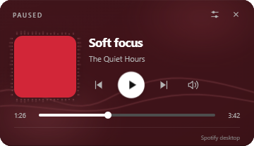
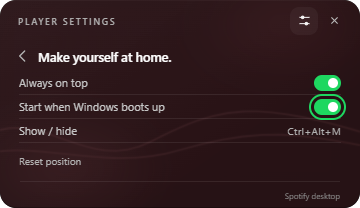

# Debra icon and playback header update

Prepared on November 18, 2026. The user reviewed the updated application, confirmed it was good, and approved pushing these changes together with the desktop shortcut and startup setting to the existing repository, authored by Devashish Bobby.

## Changes

- Replaced the application, tray, installer and browser icons with assets generated from the user-supplied `debra.jpg`. The desktop shortcut now uses the generated ICO directly.
- Removed the header status dot. The text reads **NOW PLAYING** during playback, **PAUSED** when paused, and **PLAYER SETTINGS** while Settings is open.
- Preserved the existing player controls, artwork, ambient backdrop, window geometry and startup switch.

The photo is 736 by 768 pixels. Tauri's icon generator uses `--fit cover` to center-crop it to a square without stretching it. Generation command:

```powershell
npm.cmd run tauri icon -- debra.jpg --fit cover --output src-tauri/target/debra-icons
```

Only the top-level icon files are copied into `src-tauri/icons`; generated mobile directories stay outside source control. `public/app-icon.png` is copied from the generated 128px icon.

## Checks

- `npm.cmd test`: 17 passed, including the existing player control geometry baselines at 320, 360 and 480px.
- `npm.cmd run test:live`: 32 passed, including playback header transitions, Settings header priority, removal of the dot, startup settings and protected source hashes.
- Repeated the header test after adding its synthetic paused-state screenshot: passed.
- `git diff --check`: passed.

An initial packaged-resource check caught Cargo retaining the old Windows ICO resource after only image assets changed. `src-tauri/build.rs` now explicitly watches the icons directory. `node scripts/verify-icon.mjs` checks every generated ICO frame against the final executable, so this failure is detectable without relying on the Windows shell's icon cache.

## Final packaged verification

- `npm.cmd run tauri build`: passed, producing the release executable and NSIS installer.
- `node scripts/verify-icon.mjs`: all six Debra ICO frames are embedded in the executable.
- Connected to the actual release WebView2 and verified **NOW PLAYING** against native playback status `playing`, zero status dots, **PLAYER SETTINGS** on opening Settings, and the startup switch still enabled.
- Launched the desktop shortcut and confirmed it restored the existing release instance. After the second launcher exited, exactly one SpotifyPiP process remained.
- Left the updated application open in Settings for review. No Spotify playback command was sent during packaged verification.

| Artifact | SHA-256 |
| --- | --- |
| `src-tauri/target/release/spotify-pip.exe` | `5a48473a6f674ba3dd65884f05614f95df4037e7472b02b5044b649590344b38` |
| `src-tauri/target/release/bundle/nsis/SpotifyPiP_0.1.0_x64-setup.exe` | `9d9748163c4e4d1a9de63533a51ef8d3faa90b9b8690d2510dcd6b61ee4f13df` |

The screenshots below use fictional metadata and synthetic album artwork.




