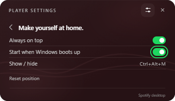

# Desktop access and Windows startup validation

Verified on Windows on November 18, 2026. The user approved publication together with the subsequent [icon and header update](ICON_HEADER_WINDOWS_TESTS.md), authored by Devashish Bobby.

## Result

- Created the current user's `SpotifyPiP.lnk` desktop shortcut with the release executable as its target and icon. Launching the shortcut restored the existing player; exactly one SpotifyPiP process remained.
- Settings includes **Start when Windows boots up**, initially enabled. It uses the current user's Windows Run entry and needs no administrator access.
- The actual release switch removed the Run entry when disabled, remained off after a full process restart, and restored the quoted executable command with `--startup` when enabled again.
- Launching the release with `--startup` kept the player hidden in the tray. A subsequent ordinary launch restored that same instance. An ordinary cold launch showed the player.
- Left the release running in Settings with startup enabled for the user's review before publication approval.

## Automated checks

| Check | Result |
| --- | --- |
| `npm.cmd test` | 17 passed |
| `npm.cmd run test:live` | 32 passed |
| `cargo test --manifest-path src-tauri/Cargo.toml --lib` | 20 passed |
| `cargo check --manifest-path src-tauri/Cargo.toml --all-targets` | Passed |
| `cargo clippy --manifest-path src-tauri/Cargo.toml --all-targets -- -D warnings` | Passed |
| `cargo fmt --manifest-path src-tauri/Cargo.toml -- --check` | Passed |
| `npm.cmd run tauri build` | Passed, executable and NSIS installer produced |
| `node scripts/verify-native-startup.mjs` | All seven packaged-app checks passed |

The native smoke test connects Playwright directly to the release's WebView2 over a temporary local debugging endpoint. It exercises the real UI and native IPC, including real startup registry writes. It requires SpotifyPiP to be quit and startup to be enabled before running, and leaves it enabled afterward. It launches its own app process and does not change Spotify playback. Native screenshot evidence is local at `test-results/native-startup-settings.png`; the public screenshot below uses synthetic fixture data.

Browser checks cover all supported window sizes, keyboard toggling, saved choices and failed-command behavior. The existing player geometry baselines and protected source hashes remain intact. The old settings snapshot is superseded by the explicit startup settings tests because this change intentionally adds a row; existing player baselines were not regenerated. JSON comparison normalizes omitted optional fields consistently with stored JSON fixtures.

## Build artifacts

These hashes record the initial startup-setting build. The final approved build, including the Debra icon and header changes, is recorded in [icon and header validation](ICON_HEADER_WINDOWS_TESTS.md).

| Artifact | SHA-256 |
| --- | --- |
| `src-tauri/target/release/spotify-pip.exe` | `97f88e54d221dc6028e7684319525867371495a32b53eaf4104ffc4cbc1b717a` |
| `src-tauri/target/release/bundle/nsis/SpotifyPiP_0.1.0_x64-setup.exe` | `a6e24dc85429d40af6dec1614c42cf51d63e1449497d9802647e07ed3030d4ac` |

No Windows reboot or sign-out was performed. The sign-in launch command and hidden behavior were verified directly. Installer installation/uninstallation and startup overrides applied through Windows Task Manager remain unverified. This setting controls SpotifyPiP's Run registration; Windows startup policy can independently prevent it from running.
